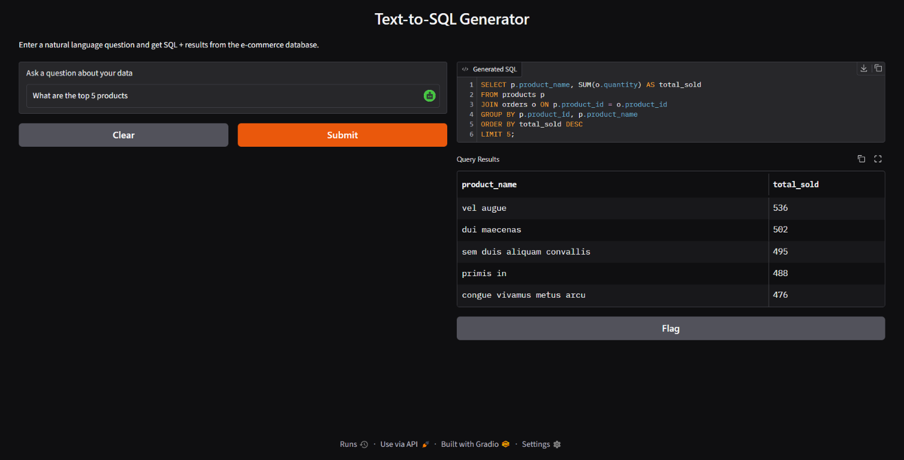
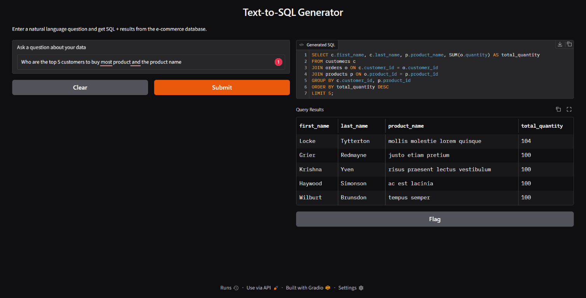

# Text-to-SQL Generator

Ask questions about sample e-commerce data in plain English and get a generated SQLite query with its results. The project includes a Gradio web interface and a FastAPI endpoint, both powered by Google Gemini.

## Screenshots

### Top products



### Top customers and products



## Features

- Translate natural-language questions into SQLite `SELECT` queries.
- Query e-commerce customer, product, and order data.
- View generated SQL and tabular results in the Gradio interface.
- Submit questions through a JSON API and get SQL, results, and a row count.

## Requirements

- Python 3.10 or newer
- A Google Gemini API key

## Setup

Clone the repository and open a terminal in the project directory. Create and activate a virtual environment, then install the dependencies:

```powershell
py -m venv .venv
.\.venv\Scripts\Activate.ps1
python -m pip install -r requirements.txt
```

Create a local `.env` file from the example and add your Gemini API key:

```powershell
Copy-Item .env.example .env
```

Edit `.env`:

```dotenv
GOOGLE_API_KEY=your_google_gemini_api_key
GEMINI_MODEL_NAME=gemini-3.8-flash
```

`GOOGLE_API_KEY` is required. `GEMINI_MODEL_NAME` is optional; when omitted, the application uses `gemini-3.8-flash`. `MOCKAROO_API_KEY` is only needed if one or more sample CSV files are missing and need to be downloaded.

On startup, the application initializes a SQLite database in the project's `data/` directory, using the included `customers.csv`, `products.csv`, and `orders.csv` files. If a required CSV is missing and `MOCKAROO_API_KEY` is configured, database setup attempts to download it from Mockaroo. The Gradio app recreates the database whenever it starts; the API creates it if it does not already exist.

## Run the Gradio app

```powershell
python main.py
```

Open the local URL printed by Gradio in your browser, enter a question, and select **Submit**. For example:

> What are the top 5 products by total quantity sold?

## Run the REST API

```powershell
python api.py
```

The API runs at `http://127.0.0.1:8000` by default. Interactive API documentation is available at `http://127.0.0.1:8000/docs`.

### Health check

```http
GET /health
```

Returns:

```json
{"status": "healthy"}
```

### Generate SQL and query results

```http
POST /text2sql
Content-Type: application/json
```

Request:

```json
{
  "query": "What are the top 5 products by total quantity sold?"
}
```

Example response:

```json
{
  "sql": "SELECT ...",
  "results": [],
  "row_count": 0
}
```

The `results` array contains the matching database rows; the example above shows the response shape only.

## Data schema

The SQLite database contains three tables:

- `customers` — customer identity and contact information, location, and loyalty points.
- `products` — product descriptions, pricing, category, inventory, ratings, and shipping details.
- `orders` — customer and product references, quantities, prices, dates, payment methods, and order status.

Database initialization is implemented in `helper.py`. It recreates the database and loads CSV data when `setup_database()` runs.

## Project structure

```text
.
├── api.py                 # FastAPI application
├── helper.py              # Database setup, query generation, and execution
├── main.py                # Gradio application
├── requirements.txt       # Python dependencies
├── .env.example           # Environment variable template
├── data/                  # Sample CSV files
└── screenshots/
    ├── results_gradio.png
    └── result_gradio_2.png
```

## Notes

- Do not commit your `.env` file or share your API key. Keep credentials in your local environment.
- Generated SQL is run against the local SQLite database; use the application with data and queries you trust.
